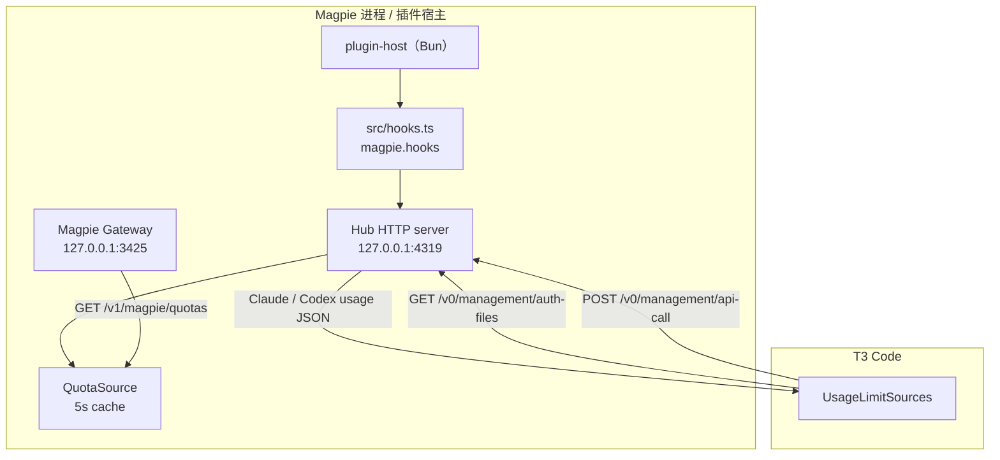
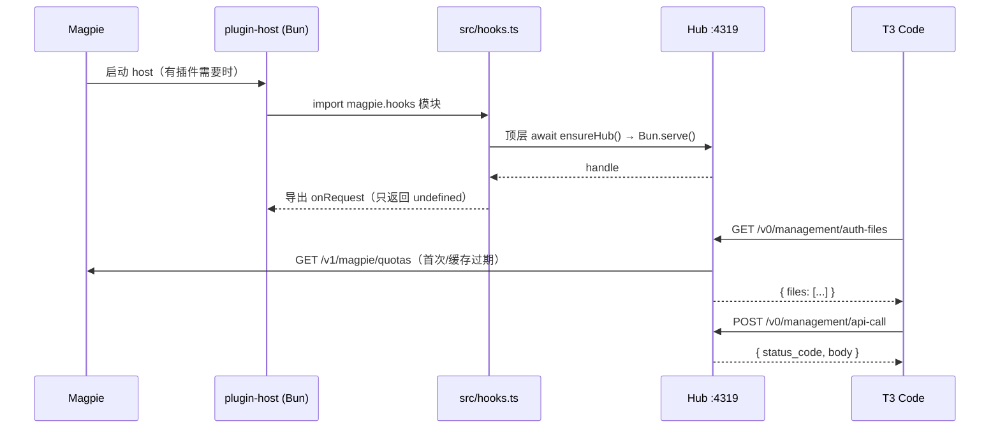

# 架构

## 总览

Hub 不接触模型流量，只读写额度：

1. Magpie 插件宿主加载插件时 import `magpie.hooks` 指向的 `src/hooks.ts`。包里没有 `main`，所以不显示 Provider 标签；另有一个空的 `magpie.middleware`（`src/hub.middleware.js`）。见 [0002](decisions/0002-declare-as-gateway-middleware.md)。
2. 模块顶层调用 `ensureHub()`，在宿主进程里 `Bun.serve()` 一个回环 HTTP 监听；`onRequest` 不改动任何请求。
3. T3 Code 把 Hub 当作一个 CLIProxyAPI Hub，读取账号列表并探测额度。
4. Hub 读取 Magpie 的 `/v1/magpie/quotas`，把窗口翻译成 T3 期望的供应商原生结构。

## 组件

| 组件 | 位置 | 职责 |
|---|---|---|
| 插件入口 | `src/hooks.ts` | request hooks 模块：从 `plugins.json` 读选项，启动/替换 Hub 单例；`onRequest` 原样放行 |
| 中间件声明 | `src/hub.middleware.js` | moejs 空中间件，只用于让 Magpie 把插件标成中间件；不改动任何请求 |
| 设置面板 | `ui/key.html` / `key.js` | Magpie 设置 → 插件里的面板：读本插件选项里的 `managementKey`，显示 Hub 地址和 key；没有时可生成一个并保存到选项（Magpie 随即重启宿主）。面板不能联网也不能读文件，所以只认选项里的 key |
| Hub 服务器 | `src/hub/server.ts` | 路由、鉴权、请求体校验、健康检查、状态文件 |
| 额度读取 | `src/hub/magpie.ts` | 请求 Magpie 额度 API，5 秒缓存，失败时返回上一份快照 |
| 映射 | `src/hub/mapping.ts` | Magpie 账号 → `auth-files`；窗口 → Claude / Codex usage |
| 鉴权 | `src/hub/auth.ts` | management key 生成/读取、Bearer 解析、常量时间比较 |
| 独立入口 | `src/standalone.ts` | 开发时不经 Magpie 插件宿主直接运行 |
| CLI | `src/cli/` | 打印 token；按 T3 的调用顺序回放验证 |

## 插件生命周期

要点：

- **宿主是长期进程**：Magpie 用 `magpie-bun run host-*.js` 维持插件宿主；Hub 的监听器随宿主存活。
- **多个宿主会短暂并存**：`magpie plugin list/add/on/off` 等 CLI 命令会启动一个临时插件宿主来加载插件。如果它发现端口上已经有一个 `service: "magpie-t3code-hub"` 的 `/healthz`，会再带自己的 key 调 `/v0/management/hub-info` 校验管理 key、Magpie URL 与 dataDir；一致才**借用**，不一致则明确报错。借用方每 2 秒探测一次，拥有端口的宿主退出后会自动接管监听，避免 Hub 随临时宿主消失。
- **插件被禁用/宿主重启**：监听器消失；宿主重新加载时 `ensureHub()` 先验证新配置（URL、token、数值范围），再 `await stop()` 旧监听器、绑定端口；如果新配置绑定失败，会尝试用旧配置恢复监听。单例挂在 `globalThis` 上，模块被重新 import 也不会丢。
- **端口冲突**：`startHub` 在 2 秒预算内最多探测 2 次是否已有同类 Hub（每次包含 750ms 上限的 `/healthz` 和 `/v0/management/hub-info`），绑定失败共重试 4 次（间隔 200ms）；仍失败则抛出明确错误，Magpie 会在插件行显示加载失败。
- **stdout 是 JSON-RPC**：插件里禁止 `console.log`，否则会污染 Magpie 与宿主之间的协议。日志统一走 `client.app.log`，独立模式走 stderr。

## 请求时序：auth-files + api-call

T3 Code 的 `UsageLimitSources` 在每次刷新时：

1. `GET /v0/management/auth-files`（带 `Authorization: Bearer <management key>`）。
2. 过滤 `!disabled && (provider === "codex" || provider === "claude")`。
3. 以并发 4 对每个账号调用 `POST /v0/management/api-call`：
   - Claude：`https://api.anthropic.com/api/oauth/usage`
   - Codex：`https://chatgpt.com/backend-api/wham/usage`，随后 `…/rate-limit-reset-credits`
4. 用 Anthropic / Codex 的原生解析器生成进度条。

Hub 侧：

- `auth-files` 触发一次 Magpie 读取（或命中 5 秒缓存），返回全部账号的投影。
- `api-call` 不重新读 Magpie，直接用同一份快照按 `auth_index` 找账号，按 URL 合成响应。
- 这保证 T3 并发探测时只有一次上游请求，也避免账号在探测中途发生变化。

## 缓存与失败策略

| 情况 | 行为 |
|---|---|
| 缓存未过期（5 秒） | 直接返回缓存 |
| 缓存过期 | 读 Magpie；成功后替换缓存 |
| 读 Magpie 失败但有旧快照 | 旧快照标记 `stale` 并缓存该状态；接下来 10 秒内直接返回旧快照，不再等待上游超时 |
| 读 Magpie 失败且无快照 | `auth-files` 返回 503、`api-call` 内层 503；记录错误并进入 10 秒退避，避免每个请求都等满超时，也避免每个请求打一条 ERROR 日志 |
| 账号在快照中不存在 | `api-call` 返回内层 `status_code: 404`，T3 将该账号标为不可用 |
| 不支持的 usage URL | `api-call` 返回内层 `status_code: 400` |

`/v1/hub/status` 的 `stale` / `staleForMs` / `expired` 来自最近一次实际返回给 T3 的快照状态。`/readyz` 与 `auth-files` 共用同一个过期判定：快照年龄不超过 `maxStaleMs`（非 stale 缓存至少保留一个 `cacheTtlMs`，且不少于 1 秒）时返回 200（即使 Magpie 暂时不可用）；没有快照或超过限制时返回 503，并触发一次后台刷新。Hub 启动后会主动预热一次额度缓存。

## 安全边界

- 默认绑定 `127.0.0.1`；若通过 `MAGPIE_T3CODE_HUB_HOST` 绑定到其他地址，启动时记一条 warn。
- 所有 `/v0/management/*` 与 `/v1/hub/status` 都要求 Bearer token。
- `/healthz` 与 `/readyz` 不需要 token，只返回 `ok` / `service` / `version`，不泄露上游 URL、错误或账号数量；诊断信息只在需要 token 的 `/v1/hub/status`。
- token 文件 `0600`；`hub.json` 只记录路径，不记录 token。
- token 创建/修复使用带 owner 的 generation 锁（`token.lock.00000001` 等）：只有 owner 能释放；等待者不删除/移动新鲜锁，只在最新锁过期后创建更高 generation。token 先写临时文件再硬链接安装，避免读者看到半写内容。空/纯空白的 token 文件会被自动修复；非空文件按原样使用。
- `api-call` 请求体上限 64 KiB（按字节，包含多字节 JSON），超限返回 413；`Content-Length` 超限时不读取正文。
- 旧快照超过 `maxStaleMs` 后，management 端点返回 503，不再把过期百分比当作当前值。
- 不记录请求头、token、账号 secret；错误日志只保留方法、路径和错误消息。

## 为什么不是其他方案

| 方案 | 结论 |
|---|---|
| Magpie gateway middleware | 运行在 moejs，无 `fetch`/定时器/Node API，不能注册路由 |
| Magpie gateway hooks | 只能改写已有模型请求，不能新增管理端点 |
| 独立 daemon | 可行，但不满足“作为 Magpie 插件运行”的要求，生命周期与 Magpie 脱节 |
| 修改 T3 Code | 能获得更自然的 UI，但超出本项目范围，且升级维护成本高 |
| 插件宿主内 `Bun.serve` | 满足插件形态、生命周期自然、实现最小 |

完整决策见 [0001-run-as-magpie-bun-plugin.md](decisions/0001-run-as-magpie-bun-plugin.md)。
