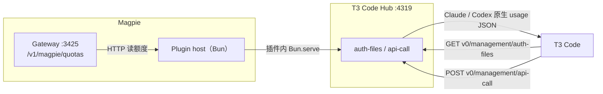

# Magpie → T3 Code 额度 Hub 知识库

`magpie-t3code-hub` 是一个 **Magpie Bun 插件**。它在 Magpie 的插件宿主里启动一个只监听本机回环地址的 HTTP 服务，把 Magpie 的额度数据翻译成 T3 Code 能识别的 **CLIProxyAPI Hub** 协议。

> 当前版本：`0.1.0`　默认监听：`127.0.0.1:4319`　数据源：Magpie `http://127.0.0.1:3425/v1/magpie/quotas`
>
> 验证环境：Magpie `0.1.3044`、T3 Code `0.1.7 (Beta)`、Bun `1.2.17`（开发）/ Magpie 内置 Bun `1.4.4`（插件宿主）。

## 数据流



- **不落盘、不代理模型请求**：Hub 只读额度，不参与推理流量。
- **短缓存**：Magpie 额度结果在 Hub 内缓存 5 秒，T3 并发探测多个账号时只读一次 Magpie。
- **纯本地**：默认只绑定 `127.0.0.1`，T3 用 management key 认证。

## 快速开始

```bash
# 依赖与质量检查
bun install
bun test
bun run typecheck

# 独立运行（不经过 Magpie 插件宿主，方便开发）
bun run dev

# 查看 management key
bun run token

# 按 T3 Code 的真实调用顺序回放一遍
bun run verify
```

安装为 Magpie 插件：

```bash
magpie plugin add /absolute/path/to/magpie-t3code-hub
magpie plugin list --json
```

T3 Code 中接入：

1. **Settings → Providers → Usage providers**
2. **Add a CLIProxyAPI hub**
3. Hub URL：`http://127.0.0.1:4319`
4. Management key：`bun run token` 的输出
5. Label：`Magpie`（可选）

详细步骤见 [开发与接入](development.md)。

## 文档地图

| 文档 | 内容 |
|---|---|
| [架构](architecture.md) | 组件、生命周期、请求时序、缓存与失败策略 |
| [Magpie 额度 API](protocol/magpie-quota-api.md) | `/v1/magpie/quotas` 的字段与语义 |
| [T3 CLIProxyAPI Hub 协议](protocol/t3-cliproxy-hub.md) | T3 Code 实际调用的端点、鉴权和原生 usage 结构 |
| [映射规则](mapping.md) | Magpie 账号/窗口 → CLIProxyAPI 账号/T3 进度条 |
| [开发与接入](development.md) | 本地开发、Magpie 插件安装、T3 配置、CodeGraph |
| [运维](operations.md) | 配置、文件、日志、健康检查、安全、排障 |
| [决策记录：作为 Magpie 插件运行](decisions/0001-run-as-magpie-bun-plugin.md) | 为什么是插件宿主里的 sidecar，而不是独立守护进程 |
| [决策记录：声明为中间件](decisions/0002-declare-as-gateway-middleware.md) | 为什么用 `magpie.hooks` + 空中间件，而不是 `main`（会带 Provider 标签） |
| [参考资料](references.md) | Magpie、T3 Code、CLIProxyAPI、CodeGraph 链接 |

## 验证状态

本项目在当前机器上已完成：

- `bun test`：93 个映射 / HTTP 契约测试通过（端口/数值校验、host/URL、text 窗口、空 token 回退、token 并发/空文件修复、缓存退避、借用接管与配置校验、ensureHub 串行化/回滚、旧快照过期、就绪检查、请求体上限、稳定账号 key、异常窗口数据）；
- `bun run typecheck`：通过；
- `magpie plugin add /Users/fuliang/Workspace/magpie-t3code-hub`：插件已加载，Hub 由 Magpie 插件宿主监听 `127.0.0.1:4319`；
- `bun run verify`：按 T3 Code 的 `auth-files` → `api-call` 顺序回放成功（验证时 Magpie 返回 14 个账号，T3 可用 11 个）。

## 核心设计

### 1. 作为 Magpie 插件运行

Magpie 的插件系统没有“注册任意 HTTP 路由”的 API。网关中间件运行在 moejs 里，不能使用 `fetch`、定时器或 Node API；gateway hooks 只能改写已有请求，不能新增路由。

但 Magpie 的 **插件宿主本身是一个长期存活的 Bun 进程**。本项目以 request hooks 声明入口（`"magpie": { "hooks": "./src/hooks.ts" }`，没有 `main`），宿主加载插件时 import 该模块，模块顶层调用 `Bun.serve()` 启动 Hub；另声明一个空的 `magpie.middleware`。Magpie 显示“中间件 + 请求 Hook”，不显示 Provider。Magpie 加载插件时，监听器随之启动；插件宿主退出或被禁用时，监听器随之消失。若同时存在另一个借用了该 Hub 的插件宿主，它会在约 2 秒内接管监听。

详见 [决策记录 0001](decisions/0001-run-as-magpie-bun-plugin.md) 与 [0002](decisions/0002-declare-as-gateway-middleware.md)。

### 2. 翻译成 T3 能吃的形状

T3 Code 的 CLIProxyAPI usage source 只处理 `provider` 为 `codex` 或 `claude` 的账号：

- 拉取 `GET v0/management/auth-files` 得到账号列表；
- 对每个账号调用 `POST v0/management/api-call`，让它去请求：
  - Claude：`https://api.anthropic.com/api/oauth/usage`
  - Codex：`https://chatgpt.com/backend-api/wham/usage` 与 reset-credits
- 按 Anthropic / Codex 的原生 JSON 结构解析成进度条。

因此 Hub 不是直接返回 Magpie 的窗口结构，而是**按 T3 发来的原生 URL，合成对应供应商的 usage JSON**。Magpie 的 Claude / Codex 账号走原生映射；其他供应商（Cursor、Qoder、WorkBuddy 等）挂在 Claude 组里一个名为 “Magpie” 的账号下，每个供应商一行 `Weekly · <供应商>`，取最紧的一个窗口。

详见 [映射规则](mapping.md)。

### 3. 认证与边界

- Hub 只绑定 `127.0.0.1`，T3 Code 用 `Authorization: Bearer <management key>` 调用管理端点。
- management key 优先取插件选项 / `MAGPIE_T3CODE_HUB_TOKEN`，否则首次启动生成并写入 `~/.config/magpie-t3code-hub/token`（`0600`）。
- 插件进程的 **stdout 属于 Magpie 的 JSON-RPC 通道**，本项目所有日志只走 `client.app.log`（插件模式）或 stderr（独立模式）。

## 已知限制

1. **T3 Code 目前只认 `codex` / `claude` 两种账号**。非原生供应商只能挂在 Claude 组里的 “Magpie” 账号下显示，行名前缀固定为 “Weekly ·”。这是 T3 的数据模型限制，不是 Hub 的数据问题。
2. **只有两个原生桶**：Codex 只有 primary / secondary；Claude 原生有 5 小时 / 7 天，其余窗口走 scoped 桶。Magpie 的更多窗口在 T3 中可能被合并或截断。
3. **余额型账号不显示**：DeepSeek 余额、OpenCode Zen 余额没有百分比窗口，T3 的进度条模型无法表达，Hub 会把这些账号标记为 disabled。
4. **reset credits 不暴露**：Magpie 没有向插件开放 reset-credit 消费接口，因此 Hub 不向 T3 广告可消费的 reset credits，避免出现点了没用的按钮。
5. **生命周期跟随 Magpie 插件宿主**：Magpie 退出、插件被禁用或插件宿主重启时，Hub 会短暂不可用。
6. **T3 Code 的 CLIProxyAPI 适配器是内部实现**：本项目按 T3 Code `0.1.7` 的实际代码验证；T3 升级后若契约变化，需要同步调整 `src/hub/mapping.ts` 与协议文档。

## 术语

| 术语 | 含义 |
|---|---|
| **Magpie Gateway** | Magpie 本机的模型网关，默认 `127.0.0.1:3425`，同时提供 `/v1/magpie/quotas` |
| **Magpie 插件宿主** | Magpie 用 Bun 启动的长期进程，加载 provider 插件与 pi package |
| **T3 Code Hub** | 本项目启动的 HTTP 服务，模拟 CLIProxyAPI 的 management API |
| **management key** | T3 Code 调用 Hub 时发送的 Bearer token |
| **auth index** | Hub 分配给每个 Magpie 账号的稳定哈希，T3 在 `api-call` 中原样带回 |
| **scoped window** | T3 Claude 适配器里可承载任意名称的窗口，UI 显示为 `Weekly · <名称>` |
