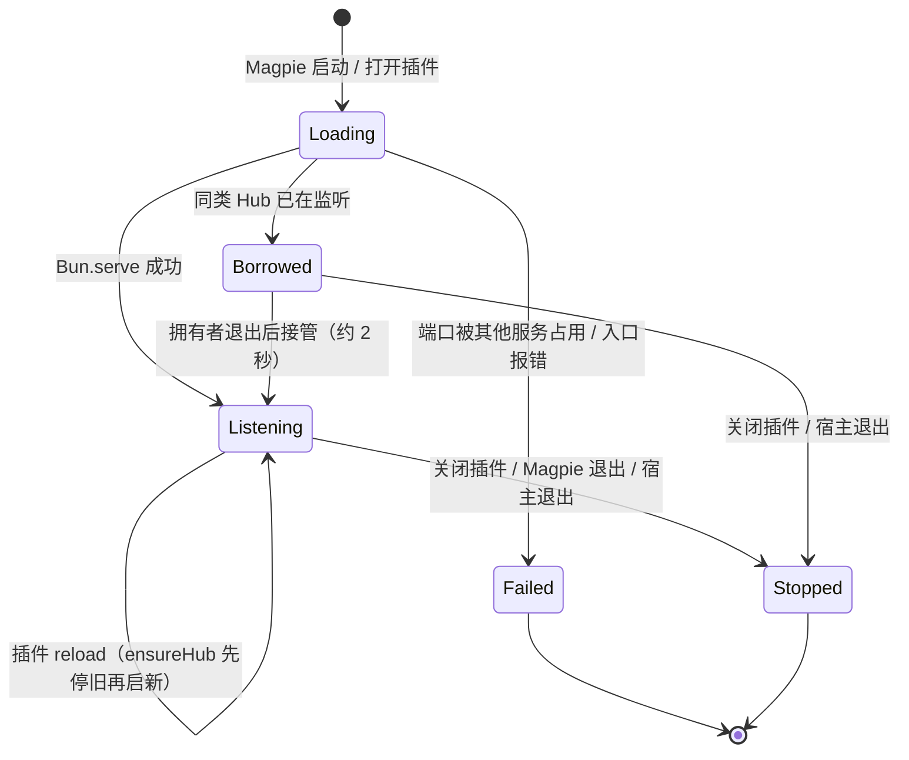

# 运维

## 默认配置

| 项目 | 默认值 |
|---|---|
| 监听地址 | `127.0.0.1:4319` |
| Magpie 额度端点 | `http://127.0.0.1:3425/v1/magpie/quotas` |
| 额度缓存 | 5 秒 |
| 旧快照最长继续提供 | 10 分钟（`maxStaleMs`） |
| 上游失败快速失败窗口 | 10 秒（`backoffMs`） |
| Magpie 读取超时 | 10 秒 |
| management key 文件 | `~/.config/magpie-t3code-hub/token` |
| 状态文件 | `~/.config/magpie-t3code-hub/hub.json` |
| 进程 | Magpie 插件宿主（Bun）内的一个监听器 |

所有默认值都可以用环境变量或 Magpie 插件选项覆盖，见 [开发与接入](development.md#配置)。

## 文件

```text
~/.config/magpie-t3code-hub/
├── token      # management key，0600；T3 Code 使用
└── hub.json   # 运行状态：service、version、pid、host、port、url、tokenPath、startedAt
```

- `hub.json` **不包含** token 本身，只记录 token 文件路径；CLI 读取时要求 `service` 标记和存活的 `pid`。
- 如果 token 来自环境变量或插件选项，`tokenPath` 为 `null`。
- 删除 `token` 后重启 Hub 会生成新 key；T3 中需要同步更新。
- `MAGPIE_T3CODE_HUB_HOME` 可以把这两个文件放到别处。

## 健康检查

```bash
# 存活：只说明进程还在
curl -s http://127.0.0.1:4319/healthz | jq
# { "ok": true, "service": "magpie-t3code-hub", "version": "0.1.0" }

# 就绪：最近一次额度读取成功且在 maxStaleMs 内
curl -s -o /dev/null -w '%{http_code}\n' http://127.0.0.1:4319/readyz
```

- `/healthz` 始终只返回 `ok` / `service` / `version`，不包含上游 URL、错误或账号数量。
- `/readyz` 返回 HTTP 200 表示可以服务：有快照，且快照未过期（旧快照在 `maxStaleMs` 宽限期内仍算可服务）。503 表示还没有快照或已超过 `maxStaleMs`；此时会在后台触发一次刷新，下一次探测就能看到结果。Hub 启动时会主动预热一次 Magpie，因此不需要等 T3 先连上来。
- 新鲜缓存至少保留一个 `cacheTtlMs`（且不少于 1 秒）的可用期，所以 `maxStaleMs=0`（甚至 `cacheTtlMs=0`）不会让刚取到的快照立刻过期。
- 两者都不需要 token，因此可以安全地绑定回环或放在监控里。
- 需要诊断信息时使用带 token 的 `/v1/hub/status`。

```bash
curl -s -H "Authorization: Bearer $(bun run token)" \
  http://127.0.0.1:4319/v1/hub/status | jq
```

返回：

- `fetchedAt` / `stale` / `staleForMs` / `expired` / `maxStaleMs`
- `lastOkAt` / `lastError`
- `upstream.url` / `upstream.accounts`
- 每个账号的 `id`、`authIndex`、`sourceProvider`、`cliproxyProvider`、`disabled`、`carriedBy`（承载它的账号，固定为 `magpie/providers`）、窗口（`used` 是从 `used` / `remaining` / `amount+limit` 推导后、与 T3 看到一致的百分比）

注意：这个端点包含账号邮箱/用户名和上游错误，属于敏感信息，需要 token。

## 日志

| 模式 | 日志去向 |
|---|---|
| Magpie 插件 | `client.app.log` → Magpie 日志（`magpie log`） |
| 独立运行 | stderr |

查看：

```bash
magpie log -n 150 | grep -i t3code
```

本项目只记录：

- 启动地址、Magpie 端点、token 文件路径（不含 token）
- 上游读取失败（每分钟最多一条）
- 请求处理中的 5xx 错误（方法 + 路径 + 消息）
- 绑定非回环地址的警告

**不会记录** token、Authorization header、账号 secret、请求体。

## 修改端口

```bash
# 方式一：环境变量（插件进程继承）
MAGPIE_T3CODE_HUB_PORT=4320

# 方式二：Magpie 插件选项
magpie plugin options magpie-t3code-hub '{"port":4320}'
```

修改后：

1. 关闭再打开插件（或重启 Magpie）。
2. 把 T3 Code 的 Hub URL 改成 `http://127.0.0.1:4320`。
3. 确认 `hub.json` 里的 port 已更新。

## 轮换 management key

```bash
rm ~/.config/magpie-t3code-hub/token
# 关闭再打开插件，或重启 Hub
bun run token
```

把新 key 更新到 T3 Code 的 Usage providers 设置。旧 key 立即失效。

也可以直接用固定 key（不推荐写入 shell 历史）：

```bash
MAGPIE_T3CODE_HUB_TOKEN='mgt_your_key' bun run dev
```

## 上游失败与缓存

| 场景 | 表现 |
|---|---|
| Magpie 暂时不可用，但有旧快照 | T3 继续看到旧额度；`/v1/hub/status` 显示 `stale: true`；10 秒退避期内直接返回旧快照；`/readyz` 在 `maxStaleMs` 宽限期内仍返回 200 |
| 旧快照超过 `maxStaleMs`（默认 10 分钟） | `auth-files` 返回 HTTP 503；`api-call` 返回内层 `status_code: 503`，T3 把这些账号标为不可用 |
| Magpie 不可用，且无快照 | `auth-files` 返回 HTTP 503，`api-call` 返回内层 `status_code: 503`；10 秒退避期内立即失败，不会每个请求都等满超时 |
| 单个账号上游读取失败，但 Magpie 返回旧窗口 | 账号仍显示；Magpie 可能在账号上带 `error`。只有存在 `readAt` 且其年龄不超过 `maxStaleMs` 时才提供旧窗口，否则 `api-call` 返回内层 503 |
| 账号登录过期 | `lapsed` 非空，Hub 把账号 disabled，T3 不显示 |
| 账号没有百分比窗口 | Hub disabled，T3 不显示；现在支持从 `remaining` 或 `amount/limit` 推导 |

## 安全

- **只绑回环**：默认 `127.0.0.1`。如果设置 `MAGPIE_T3CODE_HUB_HOST=0.0.0.0`，Hub 会暴露到局域网；token 仍然必需，但不建议。
- **token 权限**：token 文件 `0600`，状态文件 `0600`，目录 `0700`。
- **并发创建与修复**：token 创建使用递增 generation 的锁文件（`token.lock.00000001` 等），锁带 owner。等待者从不删除或移动新鲜锁；只有最新锁过期后才创建更高 generation。最终 token 先写入临时文件，再用硬链接原子安装，读者不会看到截断内容；空/纯空白的 token 文件会被自动修复，后到的宿主读取同一个 key。修复前会重新校验锁所有权和文件内容，避免删除更高 generation 已安装的 token。等待使用异步 sleep，不阻塞插件宿主的 JSON-RPC。
- **只读目录**：如果 `MAGPIE_T3CODE_HUB_HOME` 不可写且没有设置 token，插件加载会失败并提示设置 `MAGPIE_T3CODE_HUB_TOKEN` 或 `managementKey` 选项。
- **明文 HTTP**：本地回环可以接受；跨机器请使用 SSH 隧道或反向代理 + TLS，不要直接明文暴露。
- **stdout 纪律**：插件模式下 stdout 是 Magpie 的 JSON-RPC 通道。不要在插件代码里 `console.log`；用项目提供的 logger。
- **最小暴露面**：没有模型代理、没有文件读取、没有写入 Magpie 配置；`api-call` 请求体按字节限制 64 KiB。

## 生命周期与重启



- **Magpie 退出**：插件宿主退出，Hub 消失。
- **插件关闭**：宿主不再加载入口，Hub 消失。
- **插件 reload**：`ensureHub()` 先 `await stop()` 旧监听器，再绑定端口；单例保存在 `globalThis`，Magpie 重新 import 插件模块也不会丢掉旧 handle。
- **多个插件宿主**：Magpie 的 CLI 会启动临时宿主；若端口已有同类 Hub，新宿主会先验证管理 key、Magpie URL 和 dataDir 是否一致，一致才借用。配置不一致会明确报错，不会静默复用一个会 401 的 Hub。借用方每 2 秒探测一次，拥有端口的宿主退出后会自动接管监听。
- **端口短暂占用**：`startHub` 绑定失败共重试 4 次（间隔 200ms），在 2 秒预算内最多探测 2 次是否已有同类 Hub（每次探测是 `/healthz` + `/v0/management/hub-info`，各 750ms 上限），避免被不响应的进程拖慢启动；仍失败会在 Magpie 插件行显示加载错误。端口必须是 0–65535 的整数，非法值直接报错。

## 排障

| 现象 | 检查 |
|---|---|
| T3 显示 “The hub answered with HTTP 401.” | management key 不匹配；重新 `bun run token` 并更新 T3 |
| T3 显示 “The hub answered with HTTP 500/503.” | 带 token 请求 `/v1/hub/status` 看 `lastError` / `expired`；确认 Magpie 额度端点可访问 |
| T3 显示 “The hub could not read this account's usage.” | `POST api-call` 内层 `status_code`；账号可能已被 disabled 或快照过期 |
| 额度页没有账号 | `curl auth-files` 看 `files`；确认账号有窗口、未 lapsed；确认 T3 key 正确 |
| 只有 Claude/Codex，没有 Cursor/Qoder | 这是预期：其他供应商借 Claude 适配器显示，账号标签会带供应商名 |
| 非原生账号的 plan 显示 “Claude Subscription” | T3 限制；见 [映射规则](mapping.md#为什么非原生账号要借用-claude-适配器) |
| 进度条都显示 “Weekly ·” | 非原生供应商使用 scoped 桶的代价；见 [映射规则](mapping.md) |
| 看不到 reset credits / reset 按钮 | 预期：Hub 不投放 credits |
| 端口被占用 | `lsof -nP -iTCP:4319 -sTCP:LISTEN`；改端口或停掉旧进程 |
| 插件加载失败：Cannot create the management key | `MAGPIE_T3CODE_HUB_HOME` 不可写；设置 `MAGPIE_T3CODE_HUB_TOKEN` 或插件选项 `managementKey`，或换可写目录 |
| Hub 短暂 connection refused | 借用方在拥有者退出后最多约 2 秒接管；若持续不通，检查端口上的进程 |
| 插件装了但 Hub 没起来 | `magpie log -n 150`；确认 `package.json` 有 `magpie.hooks: ./src/hooks.ts`、没有 `main`；`magpie plugin list` 应显示 `async gateway hook`；关闭再打开插件 |
| Hub 起来了但 T3 连不上 | T3 的 Hub URL 是否只填 origin；是否填了 `/v0/management/...` |
| 改了源码但行为没变 | Magpie 可能缓存了插件；关闭再打开插件或重启 Magpie |
| Bun 找不到 | `export PATH="$HOME/.real/.bin:$PATH"` 或使用 Magpie 内置 `magpie-bun` |

## 快速自检脚本

```bash
set -e
curl -fsS http://127.0.0.1:4319/healthz | jq '{ok, service}'
curl -fsS -o /dev/null -w '%{http_code}\n' http://127.0.0.1:4319/readyz
KEY=$(bun run token)
curl -fsS -H "Authorization: Bearer $KEY" \
  http://127.0.0.1:4319/v0/management/auth-files | jq '.files | length'
bun run verify
```
